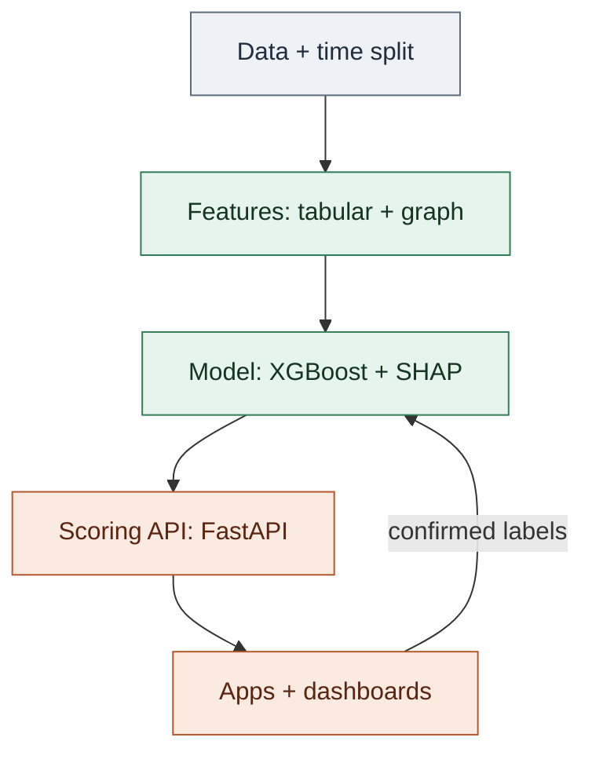
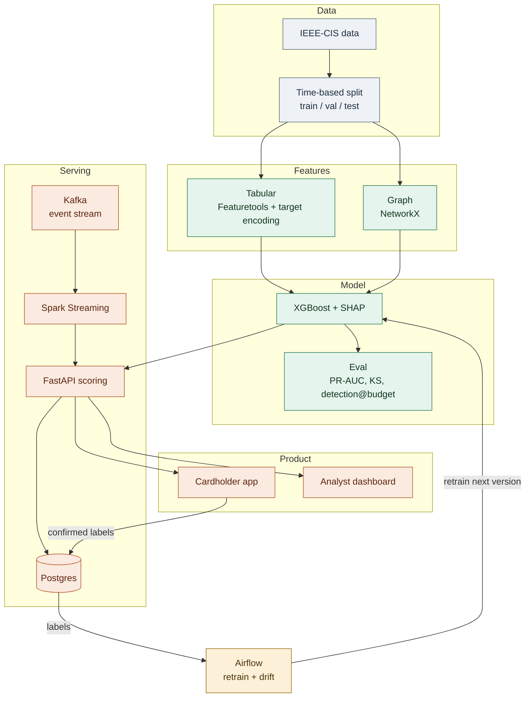
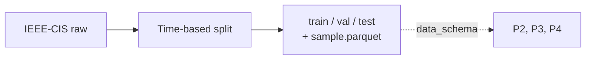
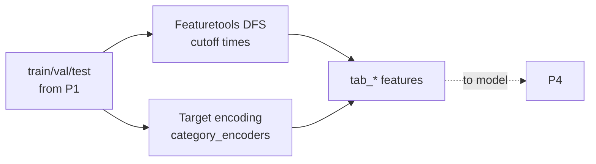
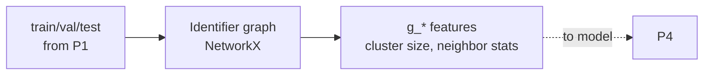
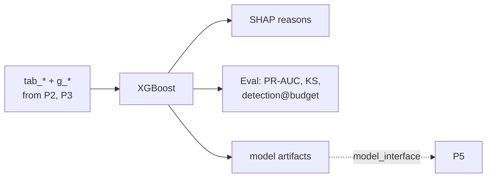
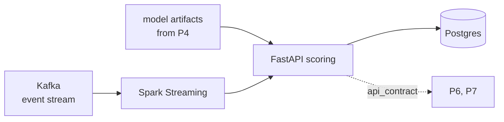
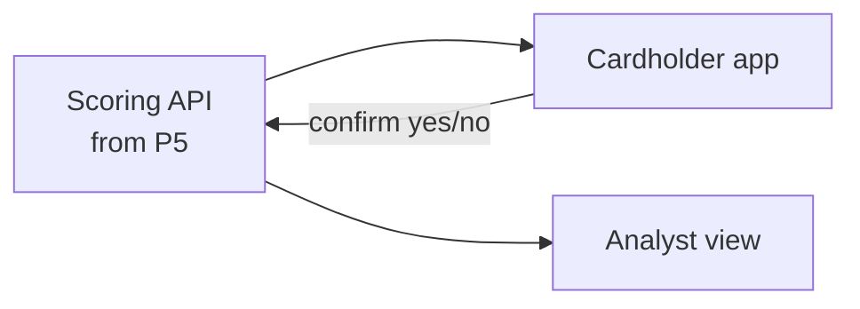
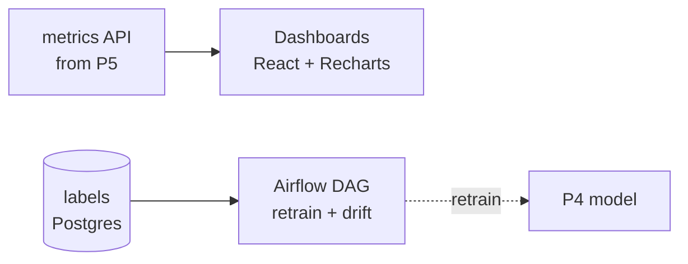

# Fraud Detection System (BTT AI Studio, Banking 1B)

A real-time card fraud detection system built on the IEEE-CIS dataset, sponsored by Mastercard through Break Through Tech. This repo is standalone for now and merges into the BTT team repo once the app is complete.

## What this is

A model that scores a card transaction for fraud, wrapped in a working system: real-time scoring, an explanation for each flag, a cardholder confirmation app whose answers retrain the model, and an analyst dashboard. The model is the assignment; the system around it is what makes it more than a notebook.

## Our "why" (read before interviews)

We justify every tool by the shape of the problem, not the size of the data. The dataset fits in memory, so we did not need distributed compute for volume. We chose streaming and orchestration deliberately, to build and reason about the production architecture:

- Fraud is a real-time event problem (decisions in milliseconds during authorization), so the scoring path is a stream.
- Production ML is recurring, scheduled, dependency-managed work, so retraining and drift checks are orchestrated.
- The data fits in memory, so the core runs in plain Python where every step is legible, and we can explain how each heavier tool would earn its place at real volume.

## Architecture

Two layers. A transparent core (the backbone, must work) and a production layer (the hireable tools, which wrap the core and never block it).

Core pipeline: data and time-based split, then features (tabular + graph), then model (XGBoost + SHAP) with honest evaluation, then FastAPI scoring, then product (apps + dashboards).

Production layer: Kafka and Spark Structured Streaming on the real-time scoring path; Airflow orchestrating feature rebuilds, retraining, and drift checks. Diagrams in docs/.

Rule: the core must run without the production layer. If streaming or orchestration slips, the demo still works.


## Architecture diagrams

### Overview



### In depth



### Per-person architecture

Each person owns one small, well-bounded piece. These show what you take in and what you hand off.

**P1 — Data and split**


**P2 — Tabular features (open-source FE)**


**P3 — Graph features**


**P4 — Model and evaluation**


**P5 — Serving and streaming**


**P6 — Front end**


**P7 — Dashboards and orchestration**



## Tech stack and the why

| Tool | Where | Why (interview answer) |
|---|---|---|
| pandas / Polars | features, core data | Data fits in memory; keep every step legible |
| NetworkX | graph features | Fraud rings are shared-identifier clusters |
| XGBoost + SHAP | model, reasons | Strong tabular model; SHAP gives per-flag reasons |
| FastAPI + Docker | scoring service | Low-latency scoring endpoint we fully control |
| Kafka | event stream | Fraud is a real-time event stream |
| Spark Structured Streaming | stream processor | Score events on arrival; fraud is a real-time stream |
| Airflow | orchestration | Retraining and drift are recurring scheduled jobs |
| React | front end | Full control over the display |
| Postgres | app state | Labels and card status |

Data note: this is the public IEEE-CIS (Vesta) dataset, a Mastercard-sponsored challenge, not Mastercard's data. No real geolocation, item categories, or calendar dates; time is a relative offset.

## Repo structure

```
contracts/      the 3 day-1 interfaces + tiny sample data (the decoupler)
data/           ingestion + time-based split            (P1)
features/
  tabular/      aggregation + velocity features          (P2)
  graph/        NetworkX ring/cluster features           (P3)
model/          training, SHAP, evaluation               (P4)
serving/
  api/          FastAPI scoring service                  (P5)
  streaming/    Kafka + Spark Structured Streaming        (P5)
frontend/       cardholder + analyst apps                (P6)
dashboards/     metrics dashboards                        (P7)
  airflow/      retrain + drift DAGs                      (P7)
docs/           diagrams and notes
```

## The 3 contracts (agree and freeze on Day 1)

Everyone builds against these, so nobody waits on anyone until integration.

1. contracts/data_schema.md: columns and types of the train/val/test tables, and the split rule (owner P1).
2. contracts/model_interface.md: input row in, {score, band, reasons} out (owner P4).
3. contracts/api_contract.md: the JSON for /score, /alerts, /metrics (owners P5 and P6).

Commit a tiny sample dataset and hardcoded sample JSON on Day 1, so the front end and dashboards can mock everything immediately.

## Per-person plan (7 people, 7 days)

Each person owns one folder. Cross-person needs go through contracts/, never by editing someone else's folder. The only real handoffs are: P1's split (Day 2), features to model (Days 3 to 4), model to serving (Days 4 to 5), and API to front end and dashboards (Days 5 to 6). Everything else runs in parallel against the frozen contracts and mocks. P1, P2, and P3 finish their heavy work by about Day 4, so their later days go to QA and to helping the two heavy lanes (P5 and P7), not to busywork.

### Detail by person

#### P1 — Data and split  (folder: data/)
Provides: train/val/test tables + sample.parquet. Owns the data_schema contract. Needs: nothing (starts first).
- D1: agree data_schema, write the time-split logic, commit sample.parquet to contracts/sample_data.
- D2: publish real train/val/test to the shared drive. Unblocks P2, P3, P4.
- D3: verify no leakage, document columns.
- D4: fix any schema issues features or model hit.
- D5: help P5 wire the real data path into serving.
- D6: integration support.
- D7: QA and demo support.

#### P2 — Tabular features  (folder: features/tabular/)
Provides: tab_* feature table. Needs: data schema (P1).
- D1: read schema, start on the sample.
- D2: build tab_* on the real train split (frequency encodings, per-card aggregates, amount and time features).
- D3: finish first pass, check the join keys with P1.
- D4: finalize, hand the table to P4.
- D5: fix issues flagged by eval.
- D6: integration; help P4.
- D7: QA and demo support.

#### P3 — Graph features  (folder: features/graph/)
Provides: g_* feature table. Needs: data schema (P1).
- D1: read schema, design nodes and edges on the sample.
- D2: build the identifier graph (card, device, email) with NetworkX.
- D3: compute g_* (cluster size, degree, time-aware neighbor fraud rate), enforcing the past-only rule.
- D4: finalize, hand to P4.
- D5: integration.
- D6: graph-neighborhood viz for the apps (P6, P7).
- D7: QA and demo support.

#### P4 — Model and evaluation  (folder: model/)
Provides: model.pkl, transform.pkl, feature_list.json, score_mapping.json, honest metrics. Owns the model-interface contract. Needs: features (P2, P3).
- D1: scaffold training + eval harness on mock features; write model_interface.
- D2: baseline model on tab_*.
- D3: combine tab_* + g_*, first real model + SHAP.
- D4: tune, publish artifacts, report PR-AUC, KS, detection at review budget.
- D5: hand model to P5.
- D6: with vs without graph comparison.
- D7: final eval, results into this README.

#### P5 — Serving and streaming  (folder: serving/)  [heaviest role]
Provides: scoring API + streaming path. Co-owns the API contract. Needs: model interface (P4), uses a dummy model until D4.
- D1: FastAPI on a dummy model returning the ScoreResult shape; Docker.
- D2: build /score, /alerts, /alerts/respond on the dummy + Postgres.
- D3: Kafka running locally + a replay script.
- D4: Spark Structured Streaming consuming Kafka; load P4's real model.
- D5: integration, real model behind the API.
- D6: streaming path end to end (Kafka to Spark to score to db).
- D7: harden, report p50 and p95 latency.

#### P6 — Front end  (folder: frontend/)
Provides: cardholder + analyst apps. Co-owns the API contract. Needs: API contract (mock until D5).
- D1: scaffold React, read the API contract, set up a mock API with static JSON.
- D2: cardholder confirm screen on the mock.
- D3: analyst view on the mock.
- D4: refine UI.
- D5: integration, point to the real API.
- D6: fix integration bugs.
- D7: demo prep.

#### P7 — Dashboards and orchestration  (folder: dashboards/, airflow/)  [second heaviest]
Provides: metrics dashboards + Airflow DAGs. Needs: /metrics contract (mock until D5).
- D1: scaffold the dashboard on mock /metrics; Airflow skeleton (docker-compose).
- D2: KPI cards + charts on the mock.
- D3: dashboards functional; draft the retrain DAG.
- D4: DAG runs retrain on a schedule + a drift check.
- D5: integration, real /metrics.
- D6: live replay over WebSocket if time allows.
- D7: harden, demo prep.

### Shared milestones
- Day 1: everyone agrees and freezes the 3 contracts, then branches.
- Day 5: integration 1 (batch path, real model and API).
- Day 6: integration 2 (streaming path).
- Day 7: rehearse the demo, write results, buffer for slippage.

### Quick view: roles and tools

| Person | Owns (folder) | Primary tools |
| --- | --- | --- |
| **P1 — Data + split** | data/ | Python, pandas or Polars, Parquet |
| **P2 — Tabular features** | features/tabular/ | pandas, scikit-learn (encoders) |
| **P3 — Graph features** | features/graph/ | NetworkX, pandas |
| **P4 — Model + evaluation** | model/ | XGBoost, SHAP, scikit-learn, MLflow |
| **P5 — Serving + streaming** | serving/ | FastAPI, Docker, Kafka, Spark Structured Streaming, Postgres |
| **P6 — Front end** | frontend/ | React / Next.js |
| **P7 — Dashboards + orchestration** | dashboards/, airflow/ | React + Recharts, Airflow, WebSocket |

### Quick view: day by day

| Person | Day 1 | Day 2 | Day 3 | Day 4 | Day 5 | Day 6 | Day 7 |
| --- | --- | --- | --- | --- | --- | --- | --- |
| **P1** | agree data_schema; commit sample.parquet | publish real split (Parquet) | leakage check; document columns | fix schema issues | help P5 wire the real data path | integration support | QA + demo support |
| **P2** | read schema; start on sample | build tab_* on train (encodings, aggregates) | finish pass; key-check with P1 | finalize; hand to P4 | fix eval-flagged issues | integration; help P4 | QA + demo support |
| **P3** | design nodes/edges on sample | build identifier graph (NetworkX) | compute g_* (past-only neighbor stats) | finalize; hand to P4 | integration | graph-neighborhood viz for apps (P6, P7) | QA + demo support |
| **P4** | eval harness on mock; write model_interface | baseline on tab_* (XGBoost) | combine tab_* + g_*; model + SHAP | tune; publish artifacts; metrics | hand model to P5 | with vs without graph compare | final eval; results into README |
| **P5** | FastAPI on dummy model; Docker | /score, /alerts, /respond; Postgres | Kafka local + replay script | Spark Streaming; load real model | integrate real model behind API | streaming end to end | harden; p50/p95 latency |
| **P6** | React scaffold; mock API (static JSON) | cardholder confirm screen (mock) | analyst view (mock) | refine UI | wire to real API | fix integration bugs | demo prep |
| **P7** | dashboard scaffold; Airflow skeleton | KPIs + charts (mock /metrics) | dashboards done; draft retrain DAG | DAG runs retrain + drift | wire real /metrics | live replay (WebSocket) | harden; demo prep |

## Scope discipline

Must finish (the grade): core model, honest time-split evaluation, FastAPI scoring, one front end. Stretch, only if the core is done: cardholder feedback loop, streaming path, Airflow. Future work (slide, not build): federated learning, extra dashboards, Databricks. A working core with a partial production layer demos well; a half-built everything does not.

Note: Kafka, Spark, and Airflow may be new to the team. They are the heaviest tools here, so treat the production layer as a deliberate stretch and protect the core first.

## How to run

(Fill in as pieces land: how to start the API, run the pipeline, launch the front end, bring up Kafka and Airflow.)

## Branch workflow

Each person works on their own branch and opens a pull request into main. Edit only your own folder; contracts/ and this README change by agreement.

```
git checkout -b p3-graph
# work in your folder, commit, then:
git push -u origin p3-graph
```