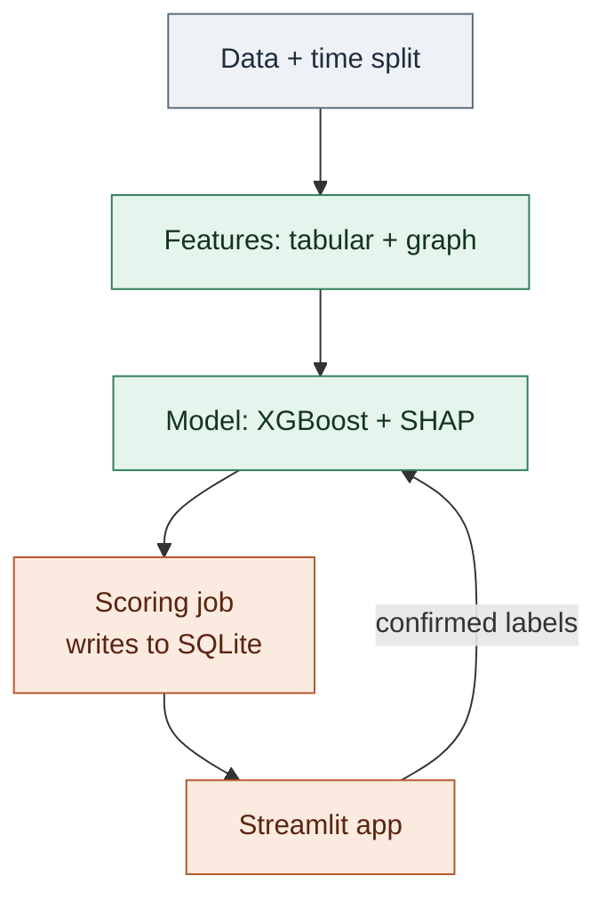
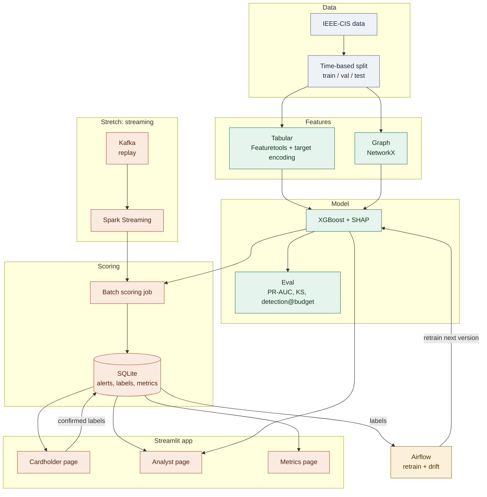
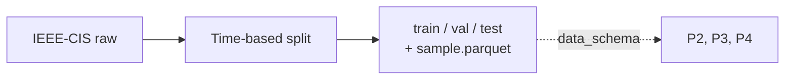
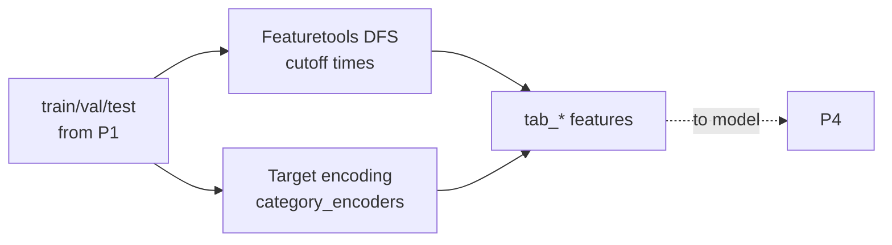
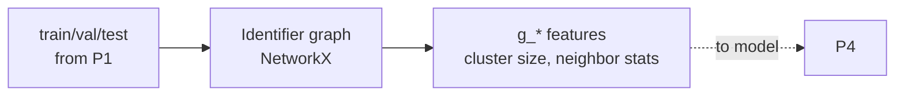
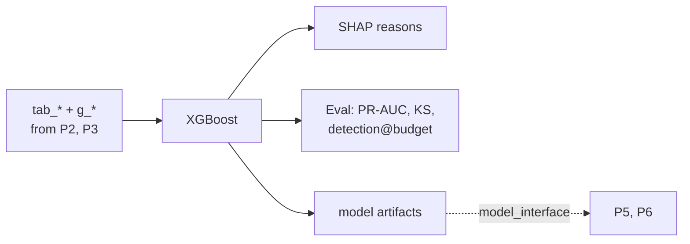
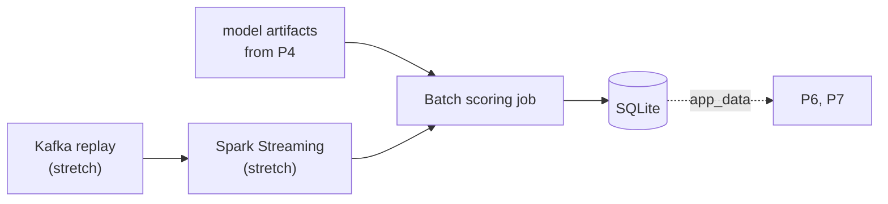
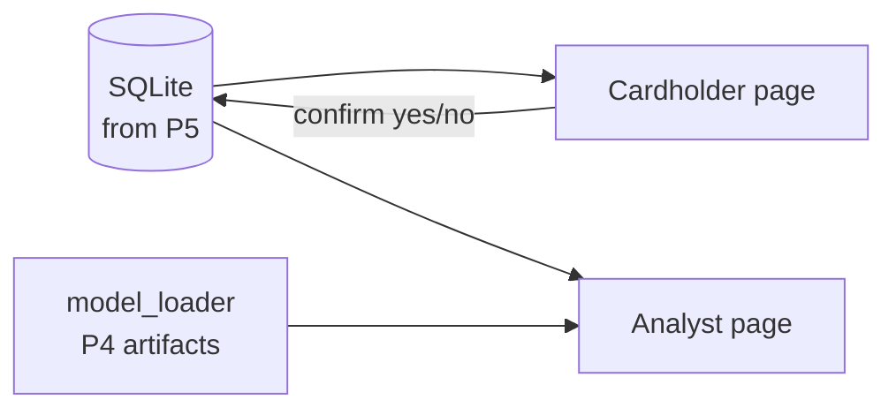
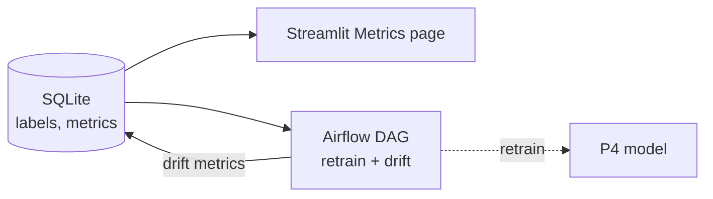

# Fraud Detection System (BTT AI Studio, Banking 1B)

A card fraud detection system built on the IEEE-CIS dataset, sponsored by Mastercard through Break Through Tech. It lives in the `fraud-system/` folder of the BTT team repo.

## What this is

A model that scores a card transaction for fraud, wrapped in a working system: scoring, an explanation for each flag, a cardholder confirmation page whose answers retrain the model, and analyst and metrics views, all in one Streamlit app. The model is the assignment; the system around it is what makes it more than a notebook.

## Our "why" (read before interviews)

We justify every tool by the shape of the problem, not the size of the data. The dataset fits in memory, so we did not need distributed compute for volume.

- The core runs in plain Python where every step is legible: pandas, XGBoost, SHAP, and a Streamlit app that loads the model directly. Streamlit gets us from model to an interactive demo fastest, and the whole team can work on it in Python.
- Production ML is recurring, scheduled work, so retraining on cardholder labels and drift checks are orchestrated with Airflow.
- Fraud is a real-time event problem (decisions in milliseconds during authorization). In production the scoring path would be a stream, so our stretch layer replays transactions through Kafka and Spark Structured Streaming. We can explain how each heavier tool would earn its place at real volume, and at what point a dedicated scoring API would replace direct model loading.

## Architecture

Two layers. A transparent core (the backbone, must work) and a production layer (the hireable tools, which wrap the core and never block it).

Core pipeline: data and time-based split, then features (tabular + graph), then model (XGBoost + SHAP) with honest evaluation, then a batch scoring job that writes alerts to SQLite, then the Streamlit app (cardholder, analyst, and metrics pages).

Production layer: Airflow orchestrating retraining and drift checks; Kafka and Spark Structured Streaming replaying transactions through the scoring path. Diagrams below.

Rule: the core must run without the production layer. If streaming or orchestration slips, the demo still works.


## Architecture diagrams

### Overview



### In depth



### Per-person architecture

Each person owns one small, well-bounded piece. These show what you take in and what you hand off.

**P1: Data and split**


**P2: Tabular features (open-source FE)**


**P3: Graph features**


**P4: Model and evaluation**


**P5: Scoring and streaming**


**P6: Streamlit cardholder and analyst pages**


**P7: Metrics page and orchestration**



## Tech stack and the why

| Tool | Where | Why (interview answer) |
|---|---|---|
| pandas / Polars | features, core data | Data fits in memory; keep every step legible |
| NetworkX | graph features | Fraud rings are shared-identifier clusters |
| XGBoost + SHAP | model, reasons | Strong tabular model; SHAP gives per-flag reasons |
| Streamlit | app (all pages) | Fastest path from model to interactive demo; all Python, loads the model directly |
| Kafka (stretch) | event replay | Fraud is a real-time event stream |
| Spark Structured Streaming (stretch) | stream processor | Score events on arrival |
| Airflow | orchestration | Retraining and drift are recurring scheduled jobs |
| SQLite | app state | Alerts, labels, metrics; one file, no server to run |

Data note: this is the public IEEE-CIS (Vesta) dataset, a Mastercard-sponsored challenge, not Mastercard's data. No real geolocation, item categories, or calendar dates; time is a relative offset.

## Repo structure

```
contracts/      the 3 day-1 interfaces + tiny sample data (the decoupler)
data/           ingestion + time-based split            (P1)
features/
  tabular/      aggregation + velocity features          (P2)
  graph/        NetworkX ring/cluster features           (P3)
model/          training, SHAP, evaluation               (P4)
scoring/        batch scoring job, writes to SQLite      (P5)
streaming/      Kafka + Spark replay (stretch)            (P5)
app/            Streamlit app: Home.py, model_loader.py
  pages/        Cardholder, Analyst                       (P6)
                Metrics                                   (P7)
orchestration/  Airflow retrain + drift DAGs              (P7)
docs/           diagrams and notes
```

## The 3 contracts (agree and freeze on Day 1)

Everyone builds against these, so nobody waits on anyone until integration.

1. contracts/data_schema.md: columns and types of the train/val/test tables, and the split rule (owner P1).
2. contracts/model_interface.md: input row in, {score, band, reasons} out (owner P4).
3. contracts/app_data.md: the SQLite tables for alerts, labels, and metrics (owners P5 and P6).

Commit a tiny sample dataset and a seeded sample_app.db on Day 1, so every Streamlit page works against mock data immediately.

## Per-person plan (7 people, 7 days)

Each person owns one folder. Cross-person needs go through contracts/, never by editing someone else's folder. The only real handoffs are: P1's split (Day 2), features to model (Days 3 to 4), model to the scoring job and app (Days 4 to 5), and scored alerts to the app pages (Days 5 to 6). Everything else runs in parallel against the frozen contracts and mocks. P1, P2, and P3 finish their heavy work by about Day 4, so their later days go to QA and to helping P5 and P7, not to busywork.

### Detail by person

#### P1: Data and split  (folder: data/)
Provides: train/val/test tables + sample.parquet. Owns the data_schema contract. Needs: nothing (starts first).
- D1: agree data_schema, write the time-split logic, commit sample.parquet to contracts/sample_data.
- D2: publish real train/val/test to the shared drive. Unblocks P2, P3, P4.
- D3: verify no leakage, document columns.
- D4: fix any schema issues features or model hit.
- D5: help P5 wire the real data path into the scoring job.
- D6: integration support.
- D7: QA and demo support.

#### P2: Tabular features  (folder: features/tabular/)
Provides: tab_* feature table. Needs: data schema (P1).
- D1: read schema, start on the sample.
- D2: build tab_* on the real train split (frequency encodings, per-card aggregates, amount and time features).
- D3: finish first pass, check the join keys with P1.
- D4: finalize, hand the table to P4.
- D5: fix issues flagged by eval.
- D6: integration; help P4.
- D7: QA and demo support.

#### P3: Graph features  (folder: features/graph/)
Provides: g_* feature table. Needs: data schema (P1).
- D1: read schema, design nodes and edges on the sample.
- D2: build the identifier graph (card, device, email) with NetworkX.
- D3: compute g_* (cluster size, degree, time-aware neighbor fraud rate), enforcing the past-only rule.
- D4: finalize, hand to P4.
- D5: integration.
- D6: graph-neighborhood viz for the Analyst page (P6).
- D7: QA and demo support.

#### P4: Model and evaluation  (folder: model/)
Provides: model.pkl, transform.pkl, feature_list.json, score_mapping.json, honest metrics. Owns the model-interface contract. Needs: features (P2, P3).
- D1: scaffold training + eval harness on mock features; write model_interface.
- D2: baseline model on tab_*.
- D3: combine tab_* + g_*, first real model + SHAP.
- D4: tune, publish artifacts, report PR-AUC, KS, detection at review budget.
- D5: hand model to P5 and P6; confirm model_loader picks it up.
- D6: with vs without graph comparison.
- D7: final eval, results into this README.

#### P5: Scoring and streaming  (folders: scoring/, streaming/)
Provides: batch scoring job + SQLite database, streaming replay as stretch. Owns the app_data contract with P6. Needs: model interface (P4), uses the dummy scorer until D4.
- D1: create the SQLite schema from app_data.md; seed sample_app.db from sample.parquet with the dummy scorer.
- D2: batch scoring job that scores the test split and writes alerts.
- D3: Kafka running locally + a replay script (stretch).
- D4: load P4's real model into the scoring job; Spark Structured Streaming consuming Kafka (stretch).
- D5: integration, real model scores in the app.
- D6: streaming replay end to end into SQLite (stretch).
- D7: harden, report scoring time per transaction.

#### P6: Streamlit cardholder and analyst pages  (folder: app/)
Provides: Home, Cardholder, and Analyst pages. Co-owns the app_data contract. Needs: sample_app.db (mock until D5), model interface (P4).
- D1: run the Streamlit skeleton, read app_data.md, point pages at sample_app.db.
- D2: Cardholder page: list pending alerts, Confirm / Not me buttons, write labels.
- D3: Analyst page: flagged table with SHAP reasons, threshold filter, single-transaction lookup.
- D4: refine layout; add "Reload model" button.
- D5: integration, point to the real app.db.
- D6: fix integration bugs; add P3's graph viz.
- D7: demo prep.

#### P7: Metrics page and orchestration  (folders: app/pages/3_Metrics.py, orchestration/)
Provides: Metrics page + Airflow DAGs. Needs: metrics and labels tables (mock until D5).
- D1: Metrics page on sample_app.db; Airflow skeleton (docker-compose).
- D2: KPI cards + charts (PR-AUC, alerts over time, share confirmed as fraud).
- D3: Metrics page done; draft the retrain DAG; run retraining by hand first.
- D4: DAG runs retrain on a schedule + a drift check that writes to metrics.
- D5: integration, real app.db.
- D6: auto-refresh on the Metrics page; show drift results.
- D7: harden, demo prep.

### Shared milestones
- Day 1: everyone agrees and freezes the 3 contracts, then branches.
- Day 5: integration 1 (batch path, real model in the app).
- Day 6: integration 2 (retrain loop; streaming path if attempted).
- Day 7: rehearse the demo, write results, buffer for slippage.

### Quick view: roles and tools

| Person | Owns (folder) | Primary tools |
| --- | --- | --- |
| **P1: Data + split** | data/ | Python, pandas or Polars, Parquet |
| **P2: Tabular features** | features/tabular/ | pandas, scikit-learn (encoders) |
| **P3: Graph features** | features/graph/ | NetworkX, pandas |
| **P4: Model + evaluation** | model/ | XGBoost, SHAP, scikit-learn, MLflow |
| **P5: Scoring + streaming** | scoring/, streaming/ | Python, SQLite, Kafka + Spark (stretch) |
| **P6: Cardholder + analyst pages** | app/ | Streamlit, SQLite |
| **P7: Metrics + orchestration** | app/pages/3_Metrics.py, orchestration/ | Streamlit, Airflow |

### Quick view: day by day

| Person | Day 1 | Day 2 | Day 3 | Day 4 | Day 5 | Day 6 | Day 7 |
| --- | --- | --- | --- | --- | --- | --- | --- |
| **P1** | agree data_schema; commit sample.parquet | publish real split (Parquet) | leakage check; document columns | fix schema issues | help P5 wire the real data path | integration support | QA + demo support |
| **P2** | read schema; start on sample | build tab_* on train (encodings, aggregates) | finish pass; key-check with P1 | finalize; hand to P4 | fix eval-flagged issues | integration; help P4 | QA + demo support |
| **P3** | design nodes/edges on sample | build identifier graph (NetworkX) | compute g_* (past-only neighbor stats) | finalize; hand to P4 | integration | graph-neighborhood viz for Analyst page | QA + demo support |
| **P4** | eval harness on mock; write model_interface | baseline on tab_* (XGBoost) | combine tab_* + g_*; model + SHAP | tune; publish artifacts; metrics | hand model to P5, P6 | with vs without graph compare | final eval; results into README |
| **P5** | SQLite schema; seed sample_app.db | batch scoring job writes alerts | Kafka + replay (stretch) | load real model; Spark (stretch) | real scores in the app | streaming into SQLite (stretch) | harden; scoring time |
| **P6** | Streamlit skeleton on sample_app.db | Cardholder page + label writes | Analyst page + SHAP reasons | refine; reload button | wire to real app.db | fix bugs; graph viz | demo prep |
| **P7** | Metrics page on sample; Airflow skeleton | KPIs + charts | page done; draft retrain DAG | DAG runs retrain + drift | wire real app.db | auto-refresh; drift view | harden; demo prep |

## Scope discipline

Must finish (the grade): core model, honest time-split evaluation, batch scoring, the Streamlit app. Stretch, only if the core is done: cardholder feedback loop, Airflow retraining, streaming path. Of the stretch items, the feedback loop and Airflow come first, because they are what make this a system rather than a notebook. Future work (slide, not build): federated learning, extra dashboards, Databricks. A working core with a partial production layer demos well; a half-built everything does not.

Note: Kafka, Spark, and Airflow may be new to the team. They are the heaviest tools here, so treat the production layer as a deliberate stretch and protect the core first.

## How to run

From the repo root, install dependencies once:

```
pip install -r requirements.txt
```

Then launch the app from `fraud-system/`:

```
streamlit run app/Home.py
```

(Fill in as pieces land: how to run the pipeline and the scoring job, bring up Airflow and Kafka.)

## Branch workflow

Each person works on their own branch and opens a pull request into main. Edit only your own folder; contracts/ and this README change by agreement.

```
git checkout -b p3-graph
# work in your folder, commit, then:
git push -u origin p3-graph
```